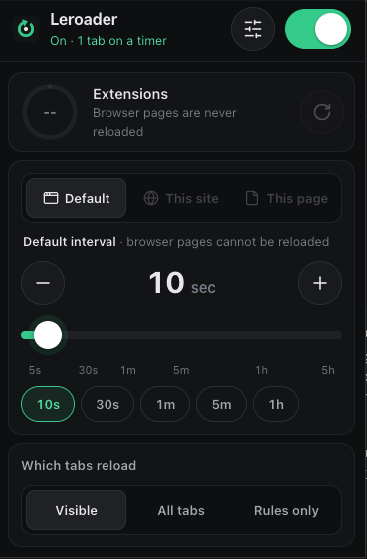
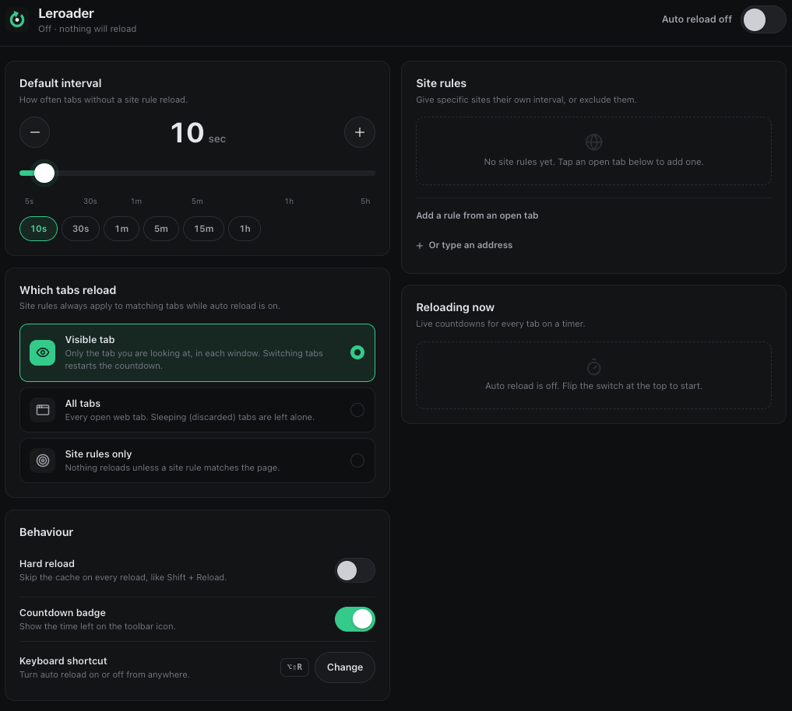

<p align="center">
  
</p>

<h1 align="center">Leroader</h1>

<p align="center">
  Auto-reload browser tabs on a timer: per-site rules, a touch-friendly interval picker and a dark UI.<br>
  Built for Brave and Chrome (Manifest V3).
</p>

<p align="center">
  
  
  
  
</p>

---

## Contents

- [Screenshots](#screenshots)
- [Features](#features)
- [Install](#install)
- [Using Leroader](#using-leroader)
  - [Which tabs reload](#which-tabs-reload)
  - [Site rules](#site-rules)
  - [Behaviour options](#behaviour-options)
- [Permissions and privacy](#permissions-and-privacy)
- [Limitations](#limitations)
- [Development](#development)
- [Project structure](#project-structure)
- [License](#license)

## Screenshots

<table>
  <tr>
    <td align="center" valign="top" width="30%">
      <br>
      <sub><b>Toolbar popup</b>: switch it on, pick an interval, choose which tabs reload</sub>
    </td>
    <td align="center" valign="top" width="70%">
      <br>
      <sub><b>Settings page</b>: default interval, scope, behaviour, site rules and live countdowns</sub>
    </td>
  </tr>
</table>

## Features

- **One switch.** On means tabs reload on schedule. Off means nothing runs at all: no timers and no background work.
- **No typing needed.** Pick any interval from 5 seconds to 5 hours with a snapping slider, −/+ buttons or quick-pick chips.
- **Three reload scopes:** only the visible tab, all tabs, or only tabs that have a site rule.
- **Site rules.** Give a whole site, a path, or one exact page its own interval, or set it to never reload. Add a rule in one tap from the popup ("This site" / "This page") or from the list of open tabs in settings.
- **Live countdowns** on the toolbar badge, in the popup ring and on the settings page, with a "reload now" button for each tab.
- **Hard reload** option that bypasses the cache, like Shift + Reload.
- **Keyboard shortcut:** `Alt+Shift+R` turns auto reload on or off from anywhere. You can change it in the browser's shortcut settings.
- **Easy on resources.** Sleeping (discarded) tabs are never woken up, and timers count from when a page *finishes* loading, so a slow page never piles up reloads.

## Install

Leroader isn't in a web store yet. To load it unpacked:

1. Download or clone this repository.
2. Open the extensions page: `brave://extensions` in Brave, `chrome://extensions` in Chrome.
3. Turn on **Developer mode** (top right).
4. Click **Load unpacked** and select the project folder (the one with `manifest.json`).
5. Pin **Leroader** to the toolbar so the countdown badge is visible.

To update after pulling changes, click the reload icon on Leroader's card on the extensions page.

## Using Leroader

1. Click the toolbar icon and flip the switch **on**.
2. Choose an interval. With **Default** selected, the interval applies to every tab without a site rule.
3. Choose **which tabs reload** (see below).
4. To give the current site its own interval, tap **This site** or **This page** before picking the interval. Tap **Default** to remove that rule again.

Click the sliders icon in the popup to open the full settings page.

### Which tabs reload

The scope decides **which** tabs reload. A site rule only decides **how often** a tab reloads, or that it never does.

| Scope | What reloads | Site rules |
|---|---|---|
| **Visible** *(default)* | The tab you're looking at in each window. Minimized windows are skipped. Switching tabs restarts the countdown. | Change the visible tab's interval. They never make background tabs reload. |
| **All tabs** | Every open web tab, except sleeping (discarded) tabs. | Each matching tab uses its rule's interval. |
| **Rules only** | Only tabs whose page matches a site rule, including background tabs. | Required: tabs without a rule never reload. |

A rule set to **Never reload** excludes matching pages in every scope.

### Site rules

| Match | Covers | Example rule → matches |
|---|---|---|
| **Whole site** | The domain and all its subdomains (`www.` is ignored) | `example.com` → `example.com/a`, `app.example.com/b` |
| **Path & below** | One path and everything under it | `example.com/dash` → `/dash`, `/dash/live`, `/dash?x=1`, but not `/dashboard` |
| **Exact page** | One exact address, including the query string | `example.com/status?env=prod` |

- When several rules match a page, the **most specific** one wins: exact page, then path, then whole site.
- Each rule has its own interval, an on/off switch, and a **Reload on a timer** / **Never reload** action.
- You can add rules from the popup, by tapping an open tab in settings, or by typing an address. An address with a path becomes a page rule; a bare domain becomes a site rule.

### Behaviour options

| Option | Default | What it does |
|---|---|---|
| Hard reload | Off | Skips the cache on every reload (like Shift + Reload). |
| Countdown badge | On | Shows the time left on the toolbar icon for the current tab. |
| Keyboard shortcut | `Alt+Shift+R` | Turns auto reload on or off. Use **Change** to open the browser's shortcut settings. |

## Permissions and privacy

| Permission | Why it's needed |
|---|---|
| `tabs` | Read tab addresses to match site rules, and reload tabs. |
| `storage` | Save your settings and rules locally. |
| `alarms` | Wake the timer loop back up if the browser suspends the background worker. |
| `favicon` | Show site icons next to rules and open tabs. |

Leroader has **no host permissions, injects no scripts into pages, and makes no network requests**. Settings are stored in `chrome.storage.local` on your device. Nothing is collected or sent anywhere.

## Limitations

- Browser pages (`brave://`, `chrome://`, the Web Store, other extensions) can't be reloaded by extensions. They're skipped.
- Only `http(s)://` and `file://` pages reload.
- The countdown badge shows the active tab of each window. Background timers are listed on the settings page.
- Reloading a page with an unsaved form discards what you typed, just like a manual reload. Use a **Never reload** rule for pages like that.

## Development

There's no build step: the extension runs straight from the source folder as plain ES modules.

```sh
# Unit tests: rule matching, scopes, formatting (Node 20+)
node --test tests/shared.test.mjs

# End-to-end: loads the extension into a real browser and counts actual reloads
npm i -D playwright
node tests/e2e.mjs                  # Playwright Chromium, headless
HEADED=1 node tests/e2e.mjs         # watch it run
BROWSER=brave node tests/e2e.mjs    # your installed Brave (macOS), throwaway profile
```

The e2e test uses a temporary profile and a local test server, so it never touches your real browser profile. It checks every scope (including the visible-tab + site-rule case), the settings and popup UI, layout at four widths, and writes screenshots to `tests/artifacts/`.

Toolbar icons are generated by `tools/make_icons.py`.

## Project structure

```
leroader/
├── manifest.json          Extension manifest (MV3)
├── background.js          Service worker: timers, reloads, badge
├── popup.html/.js/.css    Toolbar popup
├── options.html/.js/.css  Settings page
├── src/
│   ├── shared.js          Settings model, interval scale, rule matching, scope logic
│   ├── ui.js              UI components: switch, segmented control, interval picker, icons
│   └── ui.css             Shared styles and design tokens
├── icons/                 On/off toolbar icons (16–128 px)
├── docs/                  README screenshots
├── tests/
│   ├── shared.test.mjs    Unit tests
│   └── e2e.mjs            Real-browser end-to-end test
└── tools/make_icons.py    Icon generator
```

**How it works:** while auto reload is on, the service worker runs a one-second loop. Each tick asks `planForTab()` in `src/shared.js` whether a tab should reload and how often, then reloads tabs whose countdown has run out. A 30-second alarm restarts the loop if the browser suspends the worker. When auto reload is off, the loop and alarm stop completely.

## License

Released under the [MIT License](LICENSE).

Icons in the UI are from [Lucide](https://lucide.dev) (ISC License).
